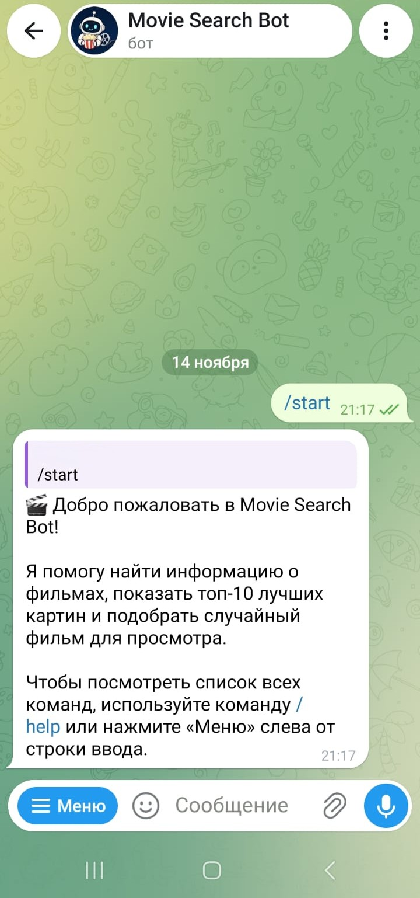
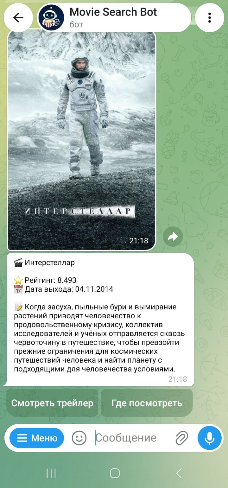
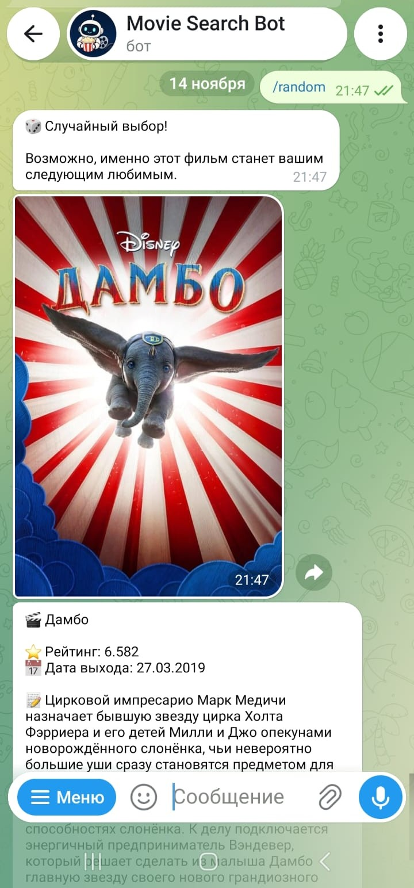
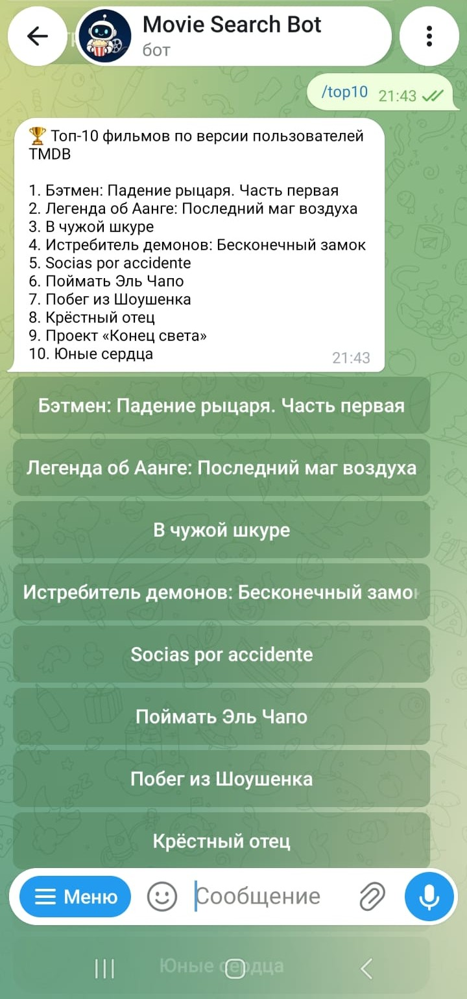
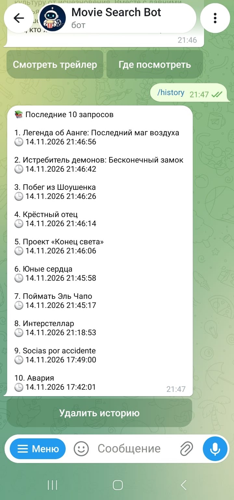

# 🎬 Movie Search Bot

Telegram-бот для поиска информации о фильмах с использованием [TMDb API](https://developer.themoviedb.org/).

Проект позволяет находить фильмы, просматривать информацию о них, получать случайные рекомендации и знакомиться с рейтингом популярных фильмов. История поисковых запросов сохраняется в базе данных SQLite.

## Возможности

- 🔎 Поиск фильма по названию.
- 🎞️ Просмотр информации о фильме:
  - название;
  - описание;
  - дата выхода;
  - рейтинг TMDb;
  - постер.
- 🎲 Получение случайного фильма.
- 🏆 Просмотр топ-10 фильмов с возможностью выбрать фильм для получения подробной информации.
- 📚 Сохранение и просмотр истории поиска.
- 🗑️ Очистка истории поиска.
- ⌨️ Удобное управление с помощью команд и кнопок меню.

## Используемые технологии

| Технология       | Назначение |
|------------------|---|
| Python 3.14.0    | Основной язык разработки |
| pyTelegramBotAPI | Взаимодействие с Telegram Bot API |
| requests         | HTTP-запросы к TMDb API |
| python-dotenv    | Загрузка конфигурации из `.env` |
| SQLAlchemy       | Работа с базой данных через ORM |
| SQLite           | Хранение истории поиска |
| Git              | Контроль версий |
| GitHub           | Хранение исходного кода |

## Используемое API

Для получения информации о фильмах используется [TMDb API](https://developer.themoviedb.org/).

Основные используемые endpoints:

| Endpoint | Назначение |
|---|---|
| `/search/movie` | Поиск фильма по названию |
| `/movie/top_rated` | Получение списка фильмов с высоким рейтингом |
| `/discover/movie` | Поиск фильмов по заданным критериям |

Полученные данные обрабатываются и преобразуются в удобный формат для отображения в Telegram.

## Команды бота

| Команда | Описание |
|---|---|
| `/start` | Запуск бота и отображение главного меню |
| `/help` | Справка по доступным командам |
| `/movie` | Поиск фильма по названию |
| `/random` | Получение случайного фильма |
| `/top10` | Просмотр топ-10 фильмов |
| `/history` | Просмотр истории поиска |

Для удобства пользователя основные действия также доступны через кнопки меню.

## Структура проекта

```text
movie-search-bot/
│
├── api/
│   └── movie_api.py
│
├── commands/
│   ├── help.py
│   ├── history.py
│   ├── movie.py
│   ├── random.py
│   ├── start.py
│   └── top10.py
│
├── database/
│   └── database.py
│
├── docs/
│   └── screenshots/
│       ├── main-menu.jpeg
│       ├── movie-search.jpeg
│       ├── random-movie.jpeg
│       ├── top-10.jpeg
│       └── search-history.jpeg
│
├── keyboards/
│   ├── history_keyboard.py
│   ├── main_menu.py
│   └── movie_keyboard.py
│
├── states/
│   └── movie_states.py
│
├── utils/
│   ├── help_message.py
│   └── movie_message.py
│
├── .env.template
├── .gitignore
├── config.py
├── loader.py
├── main.py
├── requirements.txt
└── README.md
```

## Установка и запуск

### 1. Клонирование репозитория

```bash
git clone https://github.com/NadezhdaOladko/movie-search-bot.git
cd movie-search-bot
```

### 2. Создание виртуального окружения

Windows:

```powershell
python -m venv .venv
.venv\Scripts\Activate.ps1
```

Linux / macOS:

```bash
python3 -m venv .venv
source .venv/bin/activate
```

### 3. Установка зависимостей

```bash
python -m pip install -r requirements.txt
```

### 4. Настройка переменных окружения

Создайте файл `.env` на основе шаблона:

Windows PowerShell:

```powershell
Copy-Item .env.template .env
```

Заполните `.env` необходимыми токенами и API-ключами. Их названия и назначение указаны в `.env.template`.

Для работы бота необходимы:
- токен Telegram-бота;
- учётные данные для доступа к TMDb API.

**Важно:** не публикуйте файл `.env` и не размещайте секретные ключи в открытом репозитории.

### 5. Запуск бота

```bash
python main.py
```

После запуска бот готов принимать команды в Telegram.

## База данных

Для хранения истории поисковых запросов используется SQLite.

Работа с базой данных реализована с помощью SQLAlchemy ORM.

История хранит информацию о пользователе, найденном фильме и дате поиска. Пользователь может просматривать и очищать свою историю через Telegram-бота.

## Демонстрация работы

### Главное меню


### Поиск фильма


### Случайный фильм


### Топ-10 фильмов


### История поиска


## Автор

**Надежда Оладько**

GitHub: [NadezhdaOladko](https://github.com/NadezhdaOladko)
